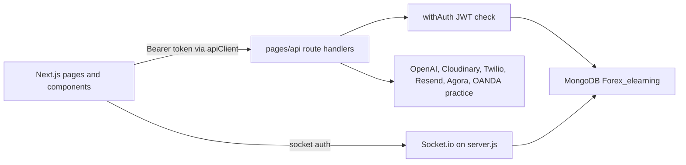

# ForexOrbit Academy — Comprehensive Audit

Audit date: 26 October 2026  
Repository: `forexorbit_academy-master` (working tree, including uncommitted UI work)  
Scope: static inspection of source, configuration names, and safe checks already run in this workspace. No fixes were applied. No database was connected or modified. Secret values are not reproduced.

Evidence labels used below:

- **Verified** — directly supported by source or a completed command.
- **Partially verified** — code path exists; end-to-end behavior was not executed.
- **Unverified** — needs credentials, a live database, or an external service.
- **Potential issue** — plausible risk that still needs confirmation.

---

## 1. Executive Summary

ForexOrbit Academy (`package.json` name `forex-elearning-app`, version `1.0.0`) is a Forex education product. The README describes courses, lessons, quizzes, role-based accounts, chat, market signals, and expert consultation. The repository implements that as one Next.js 14 application: React pages, Next API routes, MongoDB (database name `Forex_elearning`), JWT auth, Socket.io, and optional Cloudinary, OpenAI, Twilio/Termii, Resend, Agora, and OANDA practice integrations.

What is actually built is broader than a course catalog. Students can enroll, take lessons and quizzes, track progress, keep reminders and todos, earn points and badges, use a paper-trading dashboard (tasks, journal, and an OANDA practice client), and talk to an AI helper when a key is configured. Instructors and admins have course, lesson, quiz, assignment, demo-task, and analytics tools. Community, certificates, and expert consultation (including Agora calls) exist in code and are turned off by feature flags.

The most complete areas are authentication (signup, login, SMS password reset), course and lesson CRUD, enrollment and progress, quizzes, the student learning dashboard, and the instructor/admin management screens. The most fragile areas are an unauthenticated database migration endpoint that contains a hardcoded connection string, an unauthenticated SMS test endpoint, a single shared OANDA practice account model, privilege logic tied to one hardcoded email, JWT storage in `localStorage`, and almost no automated tests.

This repository is suitable for continued development and for carefully supervised internal testing. It is not ready for a public beta or production use. The migration route and embedded database credentials should be treated as an incident before any further release work. A passing typecheck and production build only show that the app compiles.

### Highest-priority actions

1. Remove the hardcoded database URI from `pages/api/migrate-lessons.ts`, disable that route, and rotate the exposed database credentials.
2. Require authentication (or delete) `POST /api/auth/test-email`, which can send SMS without a login.
3. Stop treating one email address as a permanent superadmin; store the role in the database and re-check it on each request.
4. Decide whether demo trading is an internal simulator or an OANDA practice connection, then stop sending a synthetic account id to the broker.
5. Add rate limits on login, signup, and password reset.
6. Move the session token out of `localStorage`, or document and mitigate XSS theft.
7. Add API tests for auth, enrollment, quiz grading, and object ownership.
8. Keep certificates, community, and consultations disabled until their APIs are also gated by the same flags.
9. Add a self-service account deletion path and cascade rules if the product stores personal data.
10. Do not treat the current UI polish as a substitute for the security items above.

---

## 2. Audit Scope, Methodology, and Limitations

### In scope

- Pages, components, hooks, `lib/`, `db/`, `pages/api/`, `server.js`, `middleware.ts`, seed and maintenance scripts, deployment manifests, and feature flags.
- Environment variable **names** from `.env.example`, `lib/env.ts`, `server.js`, and `render.yaml`. `.env.local` was not opened.
- Markers such as `TODO`, feature flags, and disabled navigation.

### Out of scope / not done

- No code, config, schema, or dependency changes.
- No login, signup, quiz attempt, trade, payment, email, or SMS was executed.
- No connection to MongoDB, OANDA, OpenAI, Twilio, Cloudinary, or Agora.
- No exploitation attempts.
- A fresh `npm run build` was not started against the live `.next` directory because `npm run dev` was already running. An earlier isolated production build in this workspace succeeded (see section 18).
- `npm audit` was not re-run. An earlier `npm install` in this workspace reported 31 vulnerabilities (12 moderate, 18 high, 1 critical). That count is **partially verified** and may have changed.

### How claims were checked

Routes and models were taken from file paths and `db.collection(...)` calls. Auth was checked by whether a handler uses `withAuth` and which roles it passes. “Works in production” was not inferred from a compiled page.

---

## 3. Repository and Technology Inventory

Single application. There is no separate backend package.

| Area | What the repo uses |
| --- | --- |
| UI | Next.js 14 Pages Router, React 18, TypeScript 5.9, Tailwind CSS 3 (`darkMode: 'class'`), Lucide icons, Recharts, React Quill, react-player |
| API | `pages/api/**/*.ts` on the same Next server |
| Process | `server.js` wraps Next in a Node HTTP server and attaches Socket.io at `/api/socket` |
| Data | MongoDB driver 6 (`mongodb` package). No Prisma, no SQL, no migration framework |
| Auth | `jsonwebtoken`, `bcryptjs` (cost 10). Token in `localStorage` (`hooks/useAuth.tsx`) |
| Realtime | `socket.io` / `socket.io-client` |
| Calls | `agora-rtc-sdk-ng`, `agora-token`, `agora-access-token` |
| AI | `openai` via `lib/ai.ts` (`AI_API_KEY`) |
| Files | Cloudinary (`lib/cloudinary.ts`) and `formidable` |
| Email / SMS | Resend (`lib/email.ts`); Twilio or Termii (`lib/sms.ts`) |
| Market | OANDA practice host in `lib/brokers/oanda-broker.ts` |
| Phone | `libphonenumber-js` |
| Deploy hints | `vercel.json` (function timeout 30s), `render.yaml` (Node web service, health check `/`), `netlify.toml` present. No project `.github/workflows` |
| Tests | No `test` script. No application `*.test` / `*.spec` files outside `node_modules` |
| PWA | `src/service-worker.js`, `public/manifest.json`, `components/RegisterPwa.tsx`, `components/InstallPwaPrompt.tsx` |

Runtime versions are declared, not measured on the machine beyond Node being available for the earlier typecheck (Node v22 was used for an unrelated script in this workspace).

Required env names validated at startup (`lib/env.ts`, `server.js`): `MONGO_URI`, `JWT_SECRET`. Other names referenced in code include `AI_API_KEY`, `AI_MODEL`, `AI_MAX_TOKENS`, `AI_TEMPERATURE`, `OANDA_API_KEY`, `OANDA_ACCOUNT_ID`, `OANDA_DEMO_URL`, `BROKER_DEMO_MODE`, `BROKER_TYPE`, `CLOUDINARY_CLOUD_NAME`, `CLOUDINARY_API_KEY`, `CLOUDINARY_API_SECRET`, `RESEND_API_KEY`, `RESEND_FROM`, `SMS_PROVIDER`, `SMS_DEFAULT_REGION`, `TWILIO_ACCOUNT_SID`, `TWILIO_AUTH_TOKEN`, `TWILIO_PHONE_NUMBER`, `TERMII_API_KEY`, `TERMII_SENDER_ID`, `ALLOWED_ORIGINS`, `NEXT_PUBLIC_API_BASE_URL`, `NEXT_PUBLIC_API_URL`, `NEXT_PUBLIC_SOCKET_URL`, `NEXT_PUBLIC_APP_URL`, `AGORA` app id / certificate names used by the consultation token route, `PORT`, `NODE_ENV`.

`next.config.js` also lists `MONGO_URI` and `JWT_SECRET` under the Next `env` key. That key inlines referenced values at build time. Current client pages do not import `lib/jwt.ts` or `lib/mongodb.ts` (those imports are confined to API routes and `server/socket.ts`). **Potential issue:** any future client import of those modules, or a build that pulls them into a shared chunk, would ship the secrets to the browser. They should not be in the `env` block.

Entry points:

- Browser: `pages/_app.tsx` (`ThemeProvider`, `AuthProvider`).
- Server: `server.js` (`npm run dev` and `npm start`).
- Edge: `middleware.ts` (feature redirects and cache headers only; it does not authenticate).

Styling: Tailwind tokens in `tailwind.config.js`, shared classes in `styles/globals.css` (`.btn`, `.card`, `.input`, `.page-title`). No third-party component library.

---

## 4. Architecture Overview and Diagram

A typical signed-in action:

1. A page calls `apiClient` (`lib/api-client.ts`), which uses `NEXT_PUBLIC_API_BASE_URL` or relative `/api`, and attaches `Authorization: Bearer <token>` from `localStorage`.
2. The API handler runs in the Next server. Protected handlers are wrapped in `withAuth` (`lib/auth-middleware.ts`), which verifies the JWT and optionally checks `payload.role`.
3. The handler uses `getDb()` (`lib/mongodb.ts` → `db/mongoClient.ts`) and reads or writes a Mongo collection. There is no repository or service layer; business rules live in the route files.
4. Some routes call OpenAI, Cloudinary, Twilio, Resend, Agora, or OANDA.
5. Socket.io (`server.js`) verifies the same JWT for realtime events. `lib/socket-server.ts` exposes the server to API routes when the custom server is running.

Feature flags in `lib/config/features.ts` set `CERTIFICATES`, `COMMUNITY`, and `EXPERT_CONSULTATION` to `false`. `middleware.ts` redirects those page paths to `/dashboard`. The matching API routes are not checked against these flags.

There is no payment, subscription, or entitlement service in the dependency list or API tree. Access is role-based, not plan-based.

---

## 5. Feature Inventory and Completion Matrix

Status vocabulary: implemented and verified (code path complete, not executed); partially implemented; UI only; backend exists; placeholder; disabled; not found.

| Feature | Status | Frontend | Backend | Persistence | Notes |
| --- | --- | --- | --- | --- | --- |
| Marketing home, about, help, legal, privacy, terms, support | Implemented, not executed | `pages/index.tsx`, `about.tsx`, `help.tsx`, `legal/index.tsx`, `privacy.tsx`, `terms.tsx`, `support/index.tsx` | Mostly static | None | Footer links to `/contact`, which has no page |
| Signup / login / logout | Implemented, not executed | `pages/signup.tsx`, `login.tsx`, `hooks/useAuth.tsx` | `pages/api/auth/signup.ts`, `login.ts`, `me.ts` | `users` | Students auto-approved. Instructor/admin signup is `pending`. Passwords hashed with bcrypt |
| Password reset | Implemented, not executed | `pages/forgot-password.tsx`, `reset-password.tsx` | `forgot-password.ts`, `verify-password-otp.ts`, `reset-password.ts` | `users`, password-reset collection, `passwordResetSecurityLogs` | SMS OTP via Twilio or Termii. Email reset is not the active channel |
| Email verification | Not found | — | — | — | Phone is required at signup; email is not verified |
| Profiles and onboarding | Implemented, not executed | `pages/profile.tsx`, `onboarding.tsx` | `pages/api/student/onboarding.ts`, `complete.ts`, `auth/update-phone.ts`, `upload/profile.ts` | `users` | Learning level stored on the user |
| Student learning home | Implemented, not executed | `pages/dashboard.tsx` | courses, progress, reminders, todos, leaderboard APIs | several collections | Uses real enrollment and upcoming-lesson data. No subscription metrics |
| Course catalog, detail, enroll | Implemented, not executed | `pages/courses/index.tsx`, `courses/[id].tsx`, `components/CourseCard.tsx` | `pages/api/courses/index.ts`, `[id].ts`, `[id]/enroll.ts` | `courses`, `lessons`, `progress` | Public GET. POST/PUT/DELETE require instructor or admin. Enroll is student-only and writes `progress` |
| Lessons and video | Implemented, not executed | `pages/courses/[id]/lessons/[lessonId].tsx`, `VideoPlayer.tsx`, `RichTextEditor.tsx` | `pages/api/lessons/index.ts`, `[id].ts`, `[id]/summary.ts` | `lessons`, `quizzes`, `progress` | HTML sanitized by a custom allowlist in `lib/html-sanitizer.ts`, not DOMPurify |
| Quizzes | Implemented, not executed | `components/Quiz.tsx` | `pages/api/quizzes/[lessonId].ts` | `quizzes`, `quizScores`, `progress` | Students do not receive `correctAnswer` on GET. Grading is server-side. **Partially verified** that a learner cannot resubmit forever; attempt limits were not fully traced |
| Progress | Implemented, not executed | `pages/progress.tsx`, `hooks/useProgress.ts` | `pages/api/progress/index.ts` | `progress`, `lessons`, `quizScores` | Role branches for student, instructor, and admin |
| Reminders and todos | Implemented, not executed | `RemindersPanel.tsx`, `TodoList.tsx` | `pages/api/reminders/index.ts`, `todos/index.ts` | `reminders`, `todos` | `reminders/check.ts` is admin-only and writes notifications |
| Points, badges, leaderboard | Implemented, not executed | `pages/badges.tsx`, `leaderboard.tsx` | `pages/api/badges/index.ts`, `leaderboard/index.ts`, `challenges/index.ts` | `badges`, `userBadges`, `users`, `progress`, `quizScores`, `challenges`, `challengeCompletions` | Points source should be confirmed against `users` fields at runtime |
| Trading dashboard | Partially implemented | `pages/student-dashboard.tsx`, `demo-trading.tsx`, `TradingInterface.tsx`, `MarketSignal.tsx`, `SetupGuide.tsx` | `pages/api/demo-trading/**` | `demoAccounts`, `demoTrades`, `demoTradeJournal`, `demoTasks`, `demoTaskSubmissions`, `Screenshots` | UI and API exist. Broker calls target OANDA practice with a synthetic account id. See section 10 |
| AI assistant | Implemented, not executed | `pages/ai-assistant.tsx`, `components/AIAssistant.tsx` | `pages/api/ai/answer-question.ts`, `explain-lesson.ts`, `task-hint.ts`, `analyze-trade.ts`, instructor AI routes | Optional reads of lessons, tasks, journal | Disabled when `AI_API_KEY` is missing. Health route is unauthenticated |
| Instructor tools | Implemented, not executed | `pages/instructor/dashboard.tsx`, `lessons.tsx`, `quizzes.tsx`, `courses/[courseId].tsx`, `demo-tasks.tsx`, assignment analytics page | matching `/api/lessons`, `/api/courses`, `/api/assignments`, `/api/demo-trading`, `/api/instructor/analytics` | courses, lessons, quizzes, assignments, demo tasks | Large page modules. Not exercised in a browser |
| Admin panel | Implemented, not executed | `pages/admin/index.tsx` | `pages/api/admin/users.ts`, `users/[id].ts`, `analytics.ts`, `approvals.ts`, `send-certificate.ts` | `users` and analytics collections | Superadmin is a hardcoded email, not only a stored role |
| Certificates | Disabled | `pages/certificates.tsx` | `pages/api/certificates/**` | `certificates`, `certificateTemplates` | Flag `CERTIFICATES: false`. Page redirect does not disable the API. Send-certificate email is a TODO |
| Community | Disabled | `pages/community.tsx` | `pages/api/community/**`, `forums/index.ts` | `communityRooms`, `communityMessages`, `communityNews`, `forumPosts` | Flag off. APIs still callable. Rooms are seeded on server start (`server.js` → `scripts/seed-rooms.js`) |
| Expert consultation | Disabled for learners | `pages/consultations/**`, `AgoraCall.tsx` | `pages/api/consultations/**` | `consultationRequests`, `consultationSessions`, `consultationMessages` | `/consultations/admin` is excluded from the page block. Agora token route exists |
| Classes | Backend and some UI references | instructor/admin surfaces | `pages/api/classes/index.ts` | `classes` | Not a separate public route |
| Notifications | Implemented, not executed | `components/Header.tsx` | `pages/api/notifications/**` | `notifications` | Socket event `notification` updates the header |
| Payments / subscriptions | Not found | — | — | — | No Stripe, PayPal, or entitlement checks |
| Account deletion by the user | Not found | — | Admin can `DELETE /api/admin/users/[id]` | Deletes the user document only | Related progress, messages, and trades are not cascaded in that handler |
| Contact page | UI link only | `components/Footer.tsx` href `/contact` | No `pages/contact.tsx` | — | Broken link |

---

## 6. Frontend Route and UI Audit

Shared shell: `Header`, `Sidebar` (role-based links), `Footer` on many pages, `AuthProvider`, `ThemeProvider`. Students do not get the header’s secondary nav; they use the sidebar. There is no central route guard component. Pages check `useAuth` themselves. Middleware only redirects disabled product areas and does not require a session, so unauthenticated users can open `/dashboard` until the page’s own effect redirects them. That behavior is **partially verified** from typical page patterns, not from every file.

| Route | Purpose | Access in UI | Main pieces | Backend | Verification |
| --- | --- | --- | --- | --- | --- |
| `/` | Landing | Public | `pages/index.tsx` | instructors/courses for some sections | Presentational plus data fetches; not executed |
| `/login`, `/signup`, `/forgot-password`, `/reset-password` | Auth | Public | matching pages | `/api/auth/*` | Forms exist; not executed |
| `/onboarding` | Student setup | Authenticated student | `pages/onboarding.tsx` | `/api/student/onboarding` | Not executed |
| `/dashboard` | Learning home | Intended for students | `pages/dashboard.tsx`, `CourseCard`, reminders, todos | courses, progress, points | Code uses live queries. Not clicked through |
| `/courses`, `/courses/[id]`, `/courses/[id]/lessons/[lessonId]` | Catalog and study | Mixed | course pages, `Quiz`, `VideoPlayer` | courses, lessons, quizzes, enroll | Not executed |
| `/progress` | Progress by role | Authenticated | `pages/progress.tsx` | `/api/progress` | Not executed |
| `/profile` | Account | Authenticated | `pages/profile.tsx` | user update and upload routes | Not executed |
| `/student-dashboard`, `/student-dashboard/tasks/[id]`, `/demo-trading` | Practice trading | Student | trading components | `/api/demo-trading/**` | Disclaimer text is present. Broker success unverified |
| `/ai-assistant` | Study chat | Student page checks role | `AIAssistant` | `/api/ai/*` | Not executed |
| `/leaderboard`, `/badges` | Competition | Authenticated | those pages | leaderboard, badges | Not executed |
| `/instructor/dashboard`, `/instructor/lessons`, `/instructor/quizzes`, `/instructor/courses/[courseId]`, `/instructor/demo-tasks`, `/instructor/assignments/analytics/[assignmentId]` | Teaching | Instructor | large dashboard and editors | instructor and content APIs | Not executed |
| `/admin` | Administration | Admin UI | `pages/admin/index.tsx` | `/api/admin/**` | Not executed |
| `/community` | Chat and news | Redirected to `/dashboard` while flag is false | `pages/community.tsx` | community APIs | Page blocked. API not blocked |
| `/certificates` | Certificates | Redirected | `pages/certificates.tsx` | certificates APIs | Same |
| `/consultations`, `/consultations/expert`, `/consultations/chat/[sessionId]` | Consultations | Redirected | consultation pages, `AgoraCall` | consultations APIs | Same. Admin path stays reachable |
| `/about`, `/help`, `/support`, `/legal`, `/privacy`, `/terms` | Information | Public | static pages | none | Present |
| `/contact` | Linked from footer | — | missing | — | Broken link |

UI observations (verified in source, not in a browser):

- Recent uncommitted work moved the canvas toward ivory (`#FAF8F4`), white cards, and orange `#F28C28` with near-black text on filled buttons because white-on-orange fails contrast. Dark mode remains a `class` on `html`.
- The student sidebar groups links into Learn, Practice, Community, and Account without removing destinations.
- Lucide is used for interface icons. Community emoji pickers and stored badge icons remain content.
- `lib/html-sanitizer.ts` states it is a simplified sanitizer and suggests DOMPurify for production. Lesson HTML is rendered with `dangerouslySetInnerHTML` after that sanitizer. **Potential issue** if the allowlist misses an attribute.
- Header polls notifications and listens on the socket. Sidebar refreshes the profile every 5 seconds (`components/Sidebar.tsx`). That is a concrete extra request pattern, not a measured performance failure.
- Several pages (`community.tsx`, `admin/index.tsx`, `instructor/dashboard.tsx`) are very large single files. That is maintainability debt, not a proven runtime bug.
- Empty, loading, and error states exist on the main dashboards and auth forms. They were not exercised.
- Mobile sidebar is an off-canvas panel. Overflow was not measured.

---

## 7. Backend and API Audit

There are 98 API route files under `pages/api`. Handlers are thin and talk to Mongo directly. Validation is manual (`if (!field)`) rather than a schema library. There is no global rate limiter, no request-id logging, and no structured error tracker. `console.log` in `withAuth` records the user email and role on authenticated requests (`lib/auth-middleware.ts`). Login logs the email on failure (`pages/api/auth/login.ts`).

Pagination is inconsistent. Leaderboard and some lists return full arrays. Community messages have limits in places; this was not verified for every collection.

Sensitive unauthenticated routes:

| Method | Route | Why it matters |
| --- | --- | --- |
| POST | `/api/migrate-lessons` | No `withAuth`. Rewrites lesson content. Contains a hardcoded MongoDB URI with embedded credentials as a fallback (`pages/api/migrate-lessons.ts` around line 37). **Verified in source. Do not copy that string.** |
| POST | `/api/auth/test-email` | No auth. Sends an SMS OTP to any supplied number when SMS is configured. Comment says “protect in production if needed”. |
| GET | `/api/auth/check-email-config` | No auth. Returns whether Twilio/Termii fields are set, not the secrets. |
| GET | `/api/upload/check-config-public` | No auth. Returns whether Cloudinary fields are set and `NODE_ENV`. |
| GET | `/api/ai/health`, `/api/ai/check-config` | No auth. Returns model name and whether a key exists. The `window` check in the health handler does not protect a server route. |
| POST | `/api/auth/login`, `/signup`, `/forgot-password`, `/verify-password-otp`, `/reset-password` | Intentionally public. No rate limit found. |
| GET | `/api/courses` | Public catalog. Optional JWT enriches enrollment state. |
| GET | `/api/instructors` | Public listing path exists for GET; POST is admin. |

`/api/socket.ts` is the Socket.io path served by the custom server, not a normal REST handler.

### API inventory (grouped)

Access “JWT” means `withAuth` with no extra role list (any logged-in role). Ownership filters inside the handler are noted when seen; they were not proven for every id route.

| Method | Route | Purpose | Access | Location | Data / integration | Status |
| --- | --- | --- | --- | --- | --- | --- |
| POST | `/api/auth/signup` | Create user | Public | `pages/api/auth/signup.ts` | `users`, bcrypt | Code complete |
| POST | `/api/auth/login` | Issue JWT | Public | `login.ts` | `users` | Code complete. No lockout |
| GET | `/api/auth/me` | Current user | JWT | `me.ts` | `users` | Code complete |
| POST | `/api/auth/forgot-password` | Send SMS OTP | Public | `forgot-password.ts` | users, reset collection, Twilio/Termii | Code complete |
| POST | `/api/auth/verify-password-otp` | Check OTP | Public | `verify-password-otp.ts` | reset collection | Code complete |
| POST | `/api/auth/reset-password` | Set new password | Public with OTP | `reset-password.ts` | `users` | Code complete |
| PUT | `/api/auth/update-phone` | Change phone | JWT | `update-phone.ts` | `users` | Code complete |
| POST | `/api/auth/test-email` | Send test SMS | **None** | `test-email.ts` | Twilio/Termii | Dangerous if SMS is configured |
| GET | `/api/auth/check-email-config` | SMS config booleans | **None** | `check-email-config.ts` | env presence | Information disclosure, low |
| GET/POST | `/api/courses` | List / create courses | GET public; POST instructor/admin | `courses/index.ts` | `courses`, `progress` | Code complete |
| GET/PUT/DELETE | `/api/courses/[id]` | Course record | JWT; mutations restricted in handler | `courses/[id].ts` | `courses`, `lessons`, `progress` | Not fully traced for IDOR |
| POST/DELETE | `/api/courses/[id]/enroll` | Enroll or unenroll | Student | `enroll.ts` | `progress` | Code complete |
| GET/POST | `/api/lessons` | List / create | JWT; create restricted | `lessons/index.ts` | `lessons` | Code complete |
| GET/PUT/DELETE | `/api/lessons/[id]` | Lesson | JWT | `lessons/[id].ts` | `lessons`, `quizzes` | Code complete |
| PUT | `/api/lessons/[id]/summary` | Summary | Instructor | `summary.ts` | `lessons` | Code complete |
| GET/POST/PUT | `/api/quizzes/[lessonId]` | Fetch, grade, edit | JWT; edit checks role | `quizzes/[lessonId].ts` | `quizzes`, `quizScores`, `progress` | Grading not executed |
| GET/POST | `/api/progress` | Read / update progress | JWT | `progress/index.ts` | `progress` | Role branches present |
| CRUD | `/api/reminders`, `/api/todos` | Personal lists | JWT | `reminders/index.ts`, `todos/index.ts` | own documents | Ownership should be re-checked in a test |
| POST | `/api/reminders/check` | Fan-out reminder notifications | Admin | `reminders/check.ts` | `reminders`, `notifications` | Code complete |
| CRUD | `/api/notifications` | In-app notices | JWT | `notifications/index.ts` | `notifications` | Code complete |
| GET | `/api/leaderboard` | Rankings | JWT | `leaderboard/index.ts` | users, progress, scores, certificates | Code complete |
| GET/POST | `/api/badges` | Badge catalog and awards | JWT | `badges/index.ts` | `badges`, `userBadges` | Award rules not executed |
| GET/POST | `/api/challenges` | Challenges | JWT | `challenges/index.ts` | `challenges`, completions | Not executed |
| GET/POST | `/api/classes` | Scheduled classes | JWT | `classes/index.ts` | `classes` | Not executed |
| GET/POST | `/api/assignments`, `/api/assignments/[id]` | Assignments | JWT | `assignments/*` | `assignments`, `assignmentSubmissions` | Not executed |
| POST | `/api/assignments/[id]/submit` | Student submit | JWT | `submit.ts` | submissions | Not executed |
| POST | `/api/assignments/[id]/grade` | Grade | Instructor/admin | `grade.ts` | submissions | Not executed |
| GET | `/api/assignments/[id]/analytics` | Stats | Instructor/admin | `analytics.ts` | submissions | Not executed |
| GET/POST | `/api/demo-trading/account` | Demo account | Student | `account.ts` | `demoAccounts`, OANDA | See section 10 |
| GET/POST | `/api/demo-trading/trades` | Positions and orders | Student | `trades.ts` | `demoTrades`, OANDA | See section 10 |
| POST | `/api/demo-trading/positions/[positionId]/close` | Close position | Student | `close.ts` | `demoAccounts`, broker | Not executed |
| CRUD | `/api/demo-trading/journal` | Trade journal | JWT, student paths | `journal.ts`, `journal/[id].ts` | `demoTradeJournal` | Not executed |
| POST | `/api/demo-trading/journal/upload` | Screenshot | Student | `journal/upload.ts` | `Screenshots`, Cloudinary | Not executed |
| CRUD | `/api/demo-trading/tasks` | Instructor tasks | Mixed roles | `tasks.ts` and nested routes | `demoTasks`, submissions | Not executed |
| GET | `/api/demo-trading/performance` | Stats | Student | `performance.ts` | `demoAccounts` | Not executed |
| POST | `/api/ai/answer-question` and sibling AI routes | Model calls | JWT, role lists on each file | `pages/api/ai/*` | OpenAI | Fails closed if key missing |
| GET | `/api/ai/health`, `/api/ai/check-config` | Diagnostics | **None** | those files | env flags | Should not be public |
| GET/POST | `/api/admin/users` | List users | Admin | `admin/users.ts` | `users` | Not executed |
| PUT/DELETE | `/api/admin/users/[id]` | Edit or delete user | Admin | `users/[id].ts` | `users` only | No cascade |
| GET/POST | `/api/admin/approvals` | Pending staff | Admin; approve path checks superadmin email in the handler | `approvals.ts` | `users` | Hardcoded email |
| GET | `/api/admin/analytics` | Admin charts | Admin | `analytics.ts` | several collections | Not executed |
| POST | `/api/admin/send-certificate` | Issue certificate | Admin check inside handler | `send-certificate.ts` | `certificates` | Email send is a TODO |
| CRUD | `/api/certificates/**` | Certificates | JWT; upload is admin | `certificates/*` | certificates, templates, Cloudinary | Feature flag does not block API |
| CRUD | `/api/community/**` | Rooms, messages, news | JWT | `community/*` | community collections | Feature flag does not block API |
| CRUD | `/api/consultations/**` | Requests, sessions, messages | JWT | `consultations/*` | consultation collections, Agora | `seed-experts` is admin |
| GET | `/api/consultations/agora-token` | RTC token | Must be confirmed per file | `agora-token.ts` | Agora | Not executed. Treat as sensitive |
| POST | `/api/upload/profile`, `/instructor`, `/visual-aid` | Uploads | JWT; role lists vary | `upload/*` | Cloudinary | Not executed |
| GET | `/api/upload/check-config` | Auth diagnostic | JWT | `check-config.ts` | env flags | |
| GET | `/api/upload/check-config-public` | Public diagnostic | **None** | `check-config-public.ts` | env flags | |
| GET/POST | `/api/forums` | Forum posts | JWT | `forums/index.ts` | `forumPosts` | Separate from community flag |
| GET/POST | `/api/messages` | Direct messages | JWT | `messages/index.ts` | `messages` | Not executed |
| GET/POST | `/api/instructors` | Instructor profiles | GET open; POST admin | `instructors/*` | `instructors` | Separate from `users` |
| GET | `/api/instructor/analytics` | Instructor stats | Instructor/admin | `instructor/analytics.ts` | courses, tasks | Not executed |
| POST | `/api/migrate-lessons` | Bulk lesson rewrite | **None** | `migrate-lessons.ts` | `lessons` | Must be removed or locked |

Idempotency and concurrency controls for enroll, quiz submit, and order placement were not found (no unique compound index creation in those handlers, and no transaction API usage was seen). **Potential issue:** double-submit can create duplicate progress or trades.

---

## 8. Database and Data Lifecycle Audit

MongoDB database name defaults to `Forex_elearning` (`lib/mongodb.ts`). There is no schema file, no migration history, and no unique-index module. The only `createIndex` calls found are in `pages/api/consultations/seed-experts.ts` for consultation collections. Other uniqueness (email, phone) is enforced by application `findOne` checks, which race under concurrent signups. **Potential issue.**

Collections referenced by API code:

`users`, `courses`, `lessons`, `quizzes`, `quizScores`, `progress`, `reminders`, `todos`, `notifications`, `messages`, `forumPosts`, `classes`, `challenges`, `challengeCompletions`, `badges`, `userBadges`, `certificates`, `certificateTemplates`, `assignments`, `assignmentSubmissions`, `instructors`, `demoAccounts`, `demoTrades`, `demoTasks`, `demoTaskSubmissions`, `demoTradeJournal`, `Screenshots`, `communityRooms`, `communityMessages`, `communityNews`, `consultationRequests`, `consultationSessions`, `consultationMessages`, `passwordResetSecurityLogs`, plus the password-reset collection named in `lib/password-otp.ts`.

Relationships are stored as string ids (`studentId`, `courseId`, `lessonId`), not foreign keys. Deleting a user, course, or lesson does not reliably delete dependents. `DELETE /api/admin/users/[id]` deletes one user document. Lesson delete also deletes that lesson’s quiz. Course delete was not fully traced for orphan lessons.

Seed and maintenance scripts under `scripts/` and `seed/` (`seed.js`, `seed-rooms.js`, `reset-superadmin-password.js`, `purge-visual-aids-from-db.js`, backup/restore) are operator tools. `server.js` calls `seedRooms()` on every boot. That is idempotent only if `seed-rooms.js` checks for existing rooms; the call itself is verified. Whether it is safe was not executed.

Demo accounts are documents with `isDemo: true`. They are not a separate database. A mis-set `isDemo` flag is the only broker-account guard in `trades.ts`.

No retention job, no anonymization, and no user-initiated export or deletion flow were found.

The live database was not inspected, so indexes, orphans, and real documents are **unverified**.

---

## 9. Authentication, Authorization, and Security Findings

### Confirmed in source

| ID | Severity | Finding | Evidence | Impact | Remediation |
| --- | --- | --- | --- | --- | --- |
| S1 | Critical | Unauthenticated lesson migration route with a hardcoded database connection string | `pages/api/migrate-lessons.ts` handler has no `withAuth`. Line 37 falls back to a full MongoDB URI containing a username and password | Anyone who can reach the deployment can attempt to rewrite lesson documents, and the credential in source should be treated as compromised | Delete the route from production builds, remove the URI from git history as far as practical, rotate the database user, restrict network access |
| S2 | High | Unauthenticated SMS sender | `pages/api/auth/test-email.ts` | Cost, harassment, and provider lockout if SMS credentials are present | Remove the route or require an admin secret and rate limit |
| S3 | High | Superadmin is a hardcoded email | `pages/api/auth/login.ts` (email compared to a literal), `admin/users/[id].ts`, `consultations/seed-experts.ts`, `approvals.ts` | Privilege is not revocable by changing a role field alone. The address is in the repo | Store `superadmin` on the user document, stop special-casing the email, re-read the user on each privileged request |
| S4 | High | Authorization uses the JWT role for 7 days and does not reload the user | `lib/jwt.ts` `expiresIn: '7d'`; `withAuth` trusts `payload.role` | A demoted or rejected user keeps access until expiry. Logout is client-only; the token is not revoked | Shorten TTL, check `users.status` and `users.role` in `withAuth`, or use a server session |
| S5 | High | Bearer token in `localStorage` | `hooks/useAuth.tsx` | Any XSS can steal the session | HttpOnly cookie or a strict CSP plus a proven sanitizer |
| S6 | Medium | No rate limit on login, signup, or OTP | Those handlers | Password and OTP guessing, SMS pumping via forgot-password as well as the test route | Per-IP and per-account limits, OTP attempt caps |
| S7 | Medium | Signup accepts `role: admin` or `instructor` | `pages/api/auth/signup.ts` | Creates `pending` staff accounts. Safe only if approval cannot be bypassed. Login bypasses approval for the hardcoded superadmin email | Allow public signup to create students only |
| S8 | Medium | Feature flags do not cover APIs | `lib/config/features.ts` vs community, certificate, and consultation routes | Disabled products remain callable | Share the flag check inside those handlers |
| S9 | Medium | Custom HTML sanitizer | `lib/html-sanitizer.ts` | Lesson and course HTML may still be an XSS vector | Adopt a maintained sanitizer and add tests |
| S10 | Medium | Diagnostic routes are public | `check-email-config`, `check-config-public`, `ai/health`, `ai/check-config` | Confirms which integrations are live | Restrict to operators |
| S11 | Medium | `next.config.js` `env` includes `MONGO_URI` and `JWT_SECRET` | `next.config.js` | Not currently imported by client pages. Still a footgun | Delete those keys from `env` |
| S12 | Low | Auth and login logs include email addresses | `lib/auth-middleware.ts`, `login.ts` | PII in logs | Log user ids only |
| S13 | Low | Socket.io allows requests with no `Origin` and, in development, unknown origins | `server.js` CORS callback | Cross-site websocket use if a token is stolen | Require an allowlisted origin in production |
| S14 | Info | Admin user delete does not cascade | `pages/api/admin/users/[id].ts` | Orphan personal data remains | Delete or anonymize related collections |
| S15 | Info | Password policy | `signup.ts` hashes with bcrypt and does not show a minimum length in the inspected block | Weak passwords | Enforce length and breached-password checks |

Not confirmed: a specific XSS payload, a working IDOR on a particular id, or that the hardcoded database user still authenticates. Those need dynamic tests after the credential is rotated. This is not a clean bill of health.

CSRF is less relevant while the token is sent in the `Authorization` header rather than a cookie. That advantage disappears if cookies are introduced without CSRF protection.

File uploads go through Cloudinary helpers. Size limits are set on some routes (`courses` allows a 16mb JSON body). MIME and ownership checks were not fully reviewed. **Unverified.**

Dependency vulnerabilities were reported by an earlier `npm install` audit (31 issues, including 1 critical). Packages were not inspected one by one. **Partially verified.**

---

## 10. External Integrations and Trading Safety

| Integration | Purpose | Config | Failure behavior in code | Verification |
| --- | --- | --- | --- | --- |
| MongoDB Atlas or other Mongo host | All persistence | `MONGO_URI` | Startup exits if missing (`server.js`) | Not connected |
| OpenAI | Explanations, hints, trade and student analysis | `AI_API_KEY`, optional model settings | Routes return a not-configured error via `isAIConfigured()` | Not called |
| Cloudinary | Images, screenshots, certificate files | `CLOUDINARY_*` | Upload routes error if not configured | Not called |
| Twilio or Termii | Password-reset SMS | `SMS_PROVIDER` and provider keys | Forgot-password fails if SMS is not configured | Not called |
| Resend | Password-related or future mail | `RESEND_API_KEY`, `RESEND_FROM` | Certificate email is still a TODO in `admin/send-certificate.ts` | Not called |
| Agora | Consultation audio/video | token route env | Call UI exists; feature flag hides learner pages | Not called |
| OANDA practice | Quotes and orders | `OANDA_API_KEY`, `OANDA_ACCOUNT_ID`, `OANDA_DEMO_URL` default `https://api-fxpractice.oanda.com` | Throws if the key is missing | Not called |
| Socket.io | Notifications and chat | `ALLOWED_ORIGINS`, `NEXT_PUBLIC_SOCKET_URL` | Realtime features degrade to polling or silence | Not executed |

No payment processor was found.

### Trading classification

The trading module is **not** “educational text only,” and it is **not** shown to submit orders to a live (non-practice) OANDA host.

What the code does:

- `OandaBroker` always sets demo mode and uses the practice base URL unless `OANDA_DEMO_URL` is overridden (`lib/brokers/oanda-broker.ts`).
- `BrokerFactory` throws if production is running and `BROKER_DEMO_MODE` is not `'true'` (`lib/brokers/broker-factory.ts`). FXCM and mock brokers throw “not implemented”.
- `createDemoAccount` does not open a real per-student brokerage account. It reads one configured practice account and stores a synthetic id `` `${oandaAccountId}_${studentId}` `` with a local balance (default 10000).
- `placeMarketOrder` then POSTs to `/v3/accounts/${accountId}/orders` using that stored id. Because the id is synthetic, OANDA is likely to reject the call. If a record were saved with the raw practice account id, orders would hit the **shared** practice account for every student.
- `demoTrades` is written as an application log around that broker call (`pages/api/demo-trading/trades.ts`). It is not an independent matching engine.
- The UI states that practice uses virtual money and that the academy is not a broker (`pages/dashboard.tsx`, `pages/student-dashboard.tsx`). Those sentences match the intent. They do not match a fully isolated simulator, because the order path is a broker HTTP call.

So: simulated in intent, connected to a practice market-data and order API, not confirmed to send live-account orders, and not confirmed to work. Missing safeguards: per-student isolation, a mock broker (the TODO says it is not built), timeouts around `fetch`, and tests that an order cannot escape the practice host.

---

## 11. Testing and Quality Assessment

| Layer | Present | Result |
| --- | --- | --- |
| Unit | No | — |
| API integration | No | — |
| End-to-end | No | — |
| Component | No | — |
| Authz tests | No | — |
| Migration tests | No | — |
| Payment / webhook | Not applicable | No payment code |
| Trading tests | No | — |
| CI quality gate | No project workflow file | Render `autoDeploy: true` builds on push without a test step |
| Lint | `npm run lint` (`next lint`) | Ran as part of the earlier production build; warnings only, exit 0. Warnings include `no-explicit-any`, hook dependencies, and `` |
| Typecheck | `npx tsc --noEmit` | Exit 0 on 26 October 2026 in this workspace |
| Production build | `npm run build` | Exit 0 when written to a separate output directory so it would not collide with the dev server. Not re-run for this audit |
| Accessibility / performance labs | No | — |

Critical missing tests: login and role approval, the migration route must be absent or forbidden, quiz grading and answer hiding, enroll/unenroll ownership, demo-order host lock, and OTP brute force.

---

## 12. Performance and Maintainability

Observed, not profiled:

- Sidebar profile refresh every 5 seconds while a session is open.
- Auth middleware logs on every authenticated API call.
- Course, community, admin, and instructor pages are single very large modules (community and admin are thousands of lines).
- Mongo filters use unbounded `find()` in several list endpoints. No evidence of indexes except consultation seed indexes.
- Quiz, course, and order handlers do not use transactions.
- `server.js` seeds rooms on boot and allows a permissive CORS branch for `*.vercel.app` and `onrender.com` origins.
- Duplicate broker logic versus the local `demoTrades` collection will be hard to reason about.
- Two upload stacks and two AI entry files (`lib/ai.ts`, `lib/ai-client.ts`) increase the chance of drift.
- `components/Sidebar.tsx` accepts lesson props that the component comment says are unused. Lesson pages still pass them. The lesson sidebar does not list lessons.

Hypotheses that need measurement: bundle size (Recharts, Quill, Agora, and Socket.io on student pages), N+1 progress queries, and Socket.io connection churn. Do not treat these as measured faults.

Operational gaps: no health route that checks Mongo without exposing config, no error tracking, no request ids, no backup job in the app (manual `scripts/backup-data.js` only), and deploy configs for Vercel, Render, and Netlify at the same time. `render.yaml` health check is `/`, which can return the marketing page even when Mongo is down.

---

## 13. Unfinished Features and Technical Debt

| Item | Evidence | Status | Impact | Next action |
| --- | --- | --- | --- | --- |
| Certificates, community, consultations off | `FEATURES` all `false` | Intentional flag, APIs still live | Users do not see the pages; callers still can | Gate APIs or remove routes until launch |
| Certificate email | `pages/api/admin/send-certificate.ts` TODO | Unfinished | “Send email” does not send | Implement Resend or drop the flag |
| FXCM broker | `broker-factory.ts` TODO | Not implemented | Dead option | Remove or implement |
| Mock broker | same file TODO | Not implemented | Tests and safe demo cannot run without OANDA | Add an in-memory broker and use it by default |
| Contact page | Footer href, no page | Broken link | 404 | Add a page or change the link |
| Lesson sidebar props | `Sidebar` ignores `courseId` / `lessons` | UI gap | Lesson page does not show a lesson list in the shell | Either render the list or stop passing props |
| Superadmin email comments marked “reserved” | `approvals.ts` | The check still exists in login | Confusing privilege model | One role field |
| Public diagnostics | several `check-config` routes | Left in for setup | Reconnaissance | Delete in production |
| Room seed on boot | `server.js` | Runs every start | Harmless if idempotent; noisy if not | Confirm idempotency |
| Custom sanitizer comment | `html-sanitizer.ts` | Known shortcut | XSS risk | Replace |
| No user data deletion | no self-service route | Missing | Privacy request cannot be completed in-product | Add a flow |
| Duplicate docs | many `RICHTEXT_*.md`, `DEMO_*.md`, `README_BROKER_INTEGRATION.md` | Docs may disagree with flags | Operators follow stale guides | One current operations doc |
| `index.html` at repo root | static file beside Next | Unclear if used | Confusion with `pages/index.tsx` | Confirm and remove if unused |

`TODO` / `FIXME` hits inside `node_modules` and `.next` were ignored.

---

## 14. Consolidated Findings Register

| ID | Severity | Class | Summary |
| --- | --- | --- | --- |
| S1 | Critical | Verified | Open migration endpoint and embedded database credential |
| S2 | High | Verified | Open SMS test endpoint |
| S3 | High | Verified | Hardcoded superadmin email |
| S4 | High | Verified | JWT role not rebound to the database; no server logout |
| S5 | High | Verified | Token in localStorage |
| S6 | Medium | Verified | No rate limits on auth and OTP |
| S7 | Medium | Verified | Public signup can request staff roles |
| S8 | Medium | Verified | Feature flags skip APIs |
| S9 | Medium | Potential issue | Homegrown HTML sanitizer |
| S10 | Medium | Verified | Public integration diagnostics |
| S11 | Medium | Potential issue | Secrets listed in Next `env` |
| T1 | High | Partially verified | Demo orders are aimed at one OANDA practice account with a synthetic id |
| T2 | Medium | Verified | No mock broker; practice trading cannot be tested offline |
| D1 | Medium | Verified | Almost no indexes or transactions |
| D2 | Medium | Verified | User delete does not cascade |
| Q1 | High | Verified | No application tests and no CI test gate |
| U1 | Low | Verified | `/contact` 404 |
| U2 | Info | Verified | Large page modules and 5-second profile polling |
| P1 | Info | Verified | No payments or subscriptions exist |

---

## 15. Prioritized Recommendations

### P0 — Critical

**S1. Lock down lesson migration and rotate the database user.**  
Evidence: `pages/api/migrate-lessons.ts`.  
Why: unauthenticated writes plus a leaked connection string.  
Solution: delete the route, purge the URI from the tree, rotate the Atlas user, confirm IP allowlists.  
Files: `pages/api/migrate-lessons.ts`.  
Effort: Small.  
Acceptance: unauthenticated POST returns 404; the URI is not in the repo; the old database user no longer authenticates.  
Test: HTTP request without a token; secret scan in CI.

**S2. Remove or protect the SMS test route.**  
Evidence: `pages/api/auth/test-email.ts`.  
Why: unauthenticated outbound SMS.  
Solution: delete the file or require an admin JWT and a rate limit.  
Effort: Small.  
Acceptance: anonymous POST returns 401 or 404 and sends nothing.

### P1 — High

**S3–S5. Rebuild the privilege and session check.**  
Evidence: `login.ts`, `jwt.ts`, `auth-middleware.ts`, `useAuth.tsx`.  
Why: demotion and logout do not end access; privilege is an email literal; XSS steals tokens.  
Solution: role and status columns checked on each request; shorter JWT or server session; plan a cookie migration separately from the XSS fix.  
Effort: Medium.  
Acceptance: changing `users.role` or `status` takes effect on the next API call; the literal email is gone; a stolen token test is documented.

**T1. Make demo trading either local or truly isolated.**  
Evidence: `oanda-broker.ts`, `account.ts`, `trades.ts`, `broker-factory.ts`.  
Why: the current path can fail closed or, if the raw account id is stored, place practice orders on a shared account.  
Solution: default to the missing mock broker that updates `demoAccounts` and `demoTrades` only. Keep OANDA behind an explicit operator flag and never concatenate student ids into the broker account id.  
Effort: Large.  
Acceptance: with no `OANDA_API_KEY`, a student can still place a paper trade; automated test asserts the outbound host is not called.

**Q1. Add a minimum API test suite and a CI gate before auto-deploy.**  
Evidence: `package.json` scripts, `render.yaml` `autoDeploy: true`, no `.github/workflows`.  
Effort: Medium.  
Acceptance: PRs fail when authz or migration tests fail.

### P2 — Medium

**S6, S7, S8, S10, D1, D2.** Rate limits, student-only public signup, API feature flags, removal of public diagnostics, unique indexes on `users.email` and `users.phoneE164`, and cascade or anonymize on user delete.  
Effort: Medium each, except indexes (Small).  
Acceptance is a failing test for the old behavior and a passing test for the new behavior.

**S9.** Replace the HTML sanitizer and add XSS fixture tests. Effort: Medium.

### P3 — Product polish

Fix `/contact`. Stop the 5-second profile poll or slow it down. Split `community.tsx`, `admin/index.tsx`, and `instructor/dashboard.tsx` only when those areas are next edited. Align docs with the feature flags. Add a privacy deletion flow. Continue the visual system only after P0 and P1.

Do not rewrite the app. The route and collection map is usable. The dangerous parts are specific files.

---

## 16. Proposed Development Roadmap

1. **Safety first (S1, S2, rotate credentials).** Do this before any UI sprint. A visual release that still ships the migration route is not acceptable.
2. **Session and role correctness (S3, S4, S7)** before new instructor features, so new screens do not copy the email check.
3. **Demo trading decision (T1, T2)** before more trading UI. Otherwise the dashboard will keep calling a broker path that does not match the disclaimer.
4. **API flags, rate limits, diagnostics (S6, S8, S10)** before enabling community, certificates, or consultations.
5. **Tests and CI (Q1)** as those fixes land, not as a later cleanup. Render auto-deploy should wait on the test job.
6. **Data integrity (D1, D2, privacy deletion)** before a beta that stores real students.
7. **UI and accessibility** after the above. The current ivory and orange pass is presentation. It does not change these risks.
8. **Performance profiling** only after a staging environment exists. Do not optimize the 5-second poll by guessing; either remove it or measure it.

Dependencies: trading UI depends on T1. Community launch depends on S8 and S6. Certificate email depends on Resend and the existing TODO. Session-cookie work (S5) should not start in the same change as role re-checks, or both will be hard to roll back.

---

## 17. Production Readiness Assessment

| Stage | Ready? | Why |
| --- | --- | --- |
| Continued development | Yes | The architecture is understandable and the app typechecks and builds |
| Internal testing | Only after S1 and S2 | Those two routes are unsafe on any shared URL |
| Closed beta | No | Session model, missing tests, demo-trading ambiguity, no rate limits, disabled features still have live APIs |
| Production | No | Critical findings above, no CI tests, no verified backups, no account-deletion story, dependency audit not cleared |

Readiness is **not** claimed.

---

## 18. Commands Executed and Verification Results

This audit did not re-run commands that write build output or install packages, because a dev server was already using `.next` and the instruction was not to change lockfiles.

Results from this same workspace on 26 October 2026, before this document was written:

| Command | Result | Limit |
| --- | --- | --- |
| `npx tsc --noEmit --pretty false --incremental false` | Exit 0 | Types only |
| `npm run build` with an isolated `distDir` so it would not replace the dev server’s `.next` | Exit 0. Next.js 14.2.33 compiled the Pages routes and API routes. Lint warnings did not fail the build | Does not prove runtime behavior. The isolated output directory was deleted. `next.config.js` was restored afterward and does not keep that `distDir` override |
| Earlier `npm install` audit summary | 31 vulnerabilities reported (12 moderate, 18 high, 1 critical) | Not re-run; not a fix list |
| `npm test` | Not run | No test script |

Not run, and why:

- Migrations, seed, backup, restore, password reset scripts: destructive or they send mail/SMS or write the database.
- Live login, quiz, trade, or Agora calls: need credentials and can have side effects.
- `npm audit fix`: would change the lockfile.

---

## 19. Outstanding Questions and Manual Verification Checklist

1. Does the database user embedded in `migrate-lessons.ts` still work? Rotate it regardless.
2. Is `POST /api/migrate-lessons` reachable on the deployed host?
3. Is SMS configured in production, and has `/api/auth/test-email` been called?
4. Does login with the hardcoded email still grant superadmin if that user’s `role` field is `student`?
5. After an admin sets `status: rejected`, does the old JWT still call `/api/auth/me` successfully? (Expected yes, from code.)
6. Can two parallel signups with the same email both succeed?
7. What is stored in `demoAccounts.brokerAccountId` in the real database: the synthetic id or the raw OANDA id?
8. Does `BROKER_DEMO_MODE` equal `true` in production, and which host does `OANDA_DEMO_URL` use?
9. Do quiz submissions update points once, or on every POST?
10. Do community and certificate APIs answer when the pages redirect?
11. Does `/contact` 404 in production?
12. Are Cloudinary assets public, and can one user fetch another user’s upload URL?
13. Does Agora token generation check that the caller belongs to the session?
14. Is there a Mongo backup and an Atlas IP allowlist?
15. Which deploy target is canonical: Vercel, Render, or both (API on Render, UI on Vercel)? `lib/api-client.ts` supports a separate API base URL. A split deploy means the migration route might exist on only one host. Confirm both.

---

## 20. Appendix: Key Files, Routes, Models, and Services

### Process and config

- `server.js` — HTTP server, Socket.io, room seed, CORS
- `middleware.ts` — feature-page redirects, cache headers
- `next.config.js` — images, service worker copy, `env` block
- `lib/env.ts` — requires `MONGO_URI`, `JWT_SECRET`
- `lib/config/features.ts` — product flags
- `render.yaml`, `vercel.json`, `netlify.toml`
- `.env.example` — SMS and Resend names only

### Auth and identity

- `hooks/useAuth.tsx`, `lib/api-client.ts`, `lib/jwt.ts`, `lib/auth-middleware.ts`
- `pages/api/auth/login.ts`, `signup.ts`, `me.ts`, `forgot-password.ts`, `verify-password-otp.ts`, `reset-password.ts`, `update-phone.ts`, `test-email.ts`
- `lib/password-otp.ts`, `lib/sms.ts`, `lib/email.ts`, `lib/phone.ts`

### Learning

- `pages/dashboard.tsx`, `pages/courses/*`, `pages/progress.tsx`, `components/Quiz.tsx`, `components/CourseCard.tsx`
- `pages/api/courses/*`, `pages/api/lessons/*`, `pages/api/quizzes/[lessonId].ts`, `pages/api/progress/index.ts`
- `lib/html-sanitizer.ts`, `lib/lesson-html.ts`, `lib/learning-level.ts`

### Practice trading and AI

- `pages/student-dashboard.tsx`, `components/TradingInterface.tsx`, `components/MarketSignal.tsx`
- `pages/api/demo-trading/*`
- `lib/brokers/base-broker.ts`, `oanda-broker.ts`, `broker-factory.ts`
- `lib/ai.ts`, `pages/api/ai/*`

### Staff, community, consultations

- `pages/admin/index.tsx`, `pages/instructor/dashboard.tsx`
- `pages/api/admin/*`, `pages/api/community/*`, `pages/api/consultations/*`, `pages/api/certificates/*`
- `components/AgoraCall.tsx`

### Data

- `db/mongoClient.ts`, `lib/mongodb.ts`
- Collections listed in section 8
- Scripts: `seed/seed.js`, `scripts/seed-rooms.js`, `scripts/backup-data.js`, `scripts/restore-data.js`, `scripts/reset-superadmin-password.js`

### Pages (App Router is not used)

Public and app pages live under `pages/`. The inventory in section 6 is the route list discovered from that directory. There is no `app/` router tree in use.

---

This document is an inspection of the working tree. It is not a penetration test and not a statement that any deployed environment matches this tree.

---

## Remediation addendum — 26 October 2026

The sections above are the original audit. They were not rewritten. This addendum records what was verified and changed afterward. It is not a claim that production is secure.

### Verified before editing

- `pages/api/migrate-lessons.ts` accepted unauthenticated `POST`, rewrote lesson documents, and fell back to a MongoDB connection string with an embedded username and password when `MONGO_URI` was unset. No frontend caller was found. `MIGRATION_README.md` told operators to call that route.
- The same connection string was hardcoded in `scripts/migrate-lesson-content.js`. No other source file under `pages`, `scripts`, `lib`, `db`, or `server` contained an `mongodb+srv://` credential. `lib/mongodb.ts`, `db/mongoClient.ts`, and `server.js` read `process.env.MONGO_URI` only.
- `pages/api/auth/test-email.ts` accepted unauthenticated `POST { phone }`, parsed the number, and called `sendPasswordResetOtpSms` with a random 6-digit code. It was a diagnostic, not a product flow. The real reset path remains `pages/api/auth/forgot-password.ts`.
- `next.config.js` listed `MONGO_URI` and `JWT_SECRET` under `env`, which inlines those values into build output. Existing `.next` server bundles from earlier builds contained the database URI for that reason. `.env.local` was not opened.
- Login (`pages/api/auth/login.ts`) treats one email as superadmin: it skips approval checks and sets the JWT role to `superadmin` even when `users.role` is something else. `pages/api/auth/me.ts` applies the same email override to the role it returns. `withAuth` trusts the role inside the JWT for 7 days and does not reload the user document.
- The same email is also used as a contact address in `pages/terms.tsx` and `pages/privacy.tsx`, as seed data in `seed/seed.js` (`role: 'superadmin'`), and as a lookup key for `consultationEnabled` in `pages/api/consultations/admin.ts` and `pages/api/consultations/requests.ts`.
- `scripts/set-superadmin.js` and `scripts/reset-superadmin-password.js` contained fixed passwords and could create or reset privileged accounts. They were not run.
- There is still no application test runner beyond Node’s built-in `node:test`. No packages were installed.

### Changes in this sprint

| Change | Files | Result |
| --- | --- | --- |
| Removed the public lesson migration route | Deleted `pages/api/migrate-lessons.ts` and its compiled `.next` route files | The route is not in source. Next will not build it. This workspace did not send a POST to it, because an old in-memory dev server could still have held the previous handler and a POST could have written to the database. |
| Removed the matching script and its connection string | Deleted `scripts/migrate-lesson-content.js` | No source copy of that SRV credential remains. |
| Removed the SMS diagnostic route | Deleted `pages/api/auth/test-email.ts` and its compiled `.next` route files | Unauthorized callers no longer have a source handler that can send SMS. `forgot-password` was not changed. |
| Stopped build-time inlining of database and JWT secrets | `next.config.js` | `MONGO_URI` and `JWT_SECRET` stay in the process environment. They are not copied into the client bundle by the Next `env` option. Runtime reads in `server.js`, `db/mongoClient.ts`, and `lib/jwt.ts` are unchanged. |
| Retired the migration instructions | `MIGRATION_README.md` | The file no longer tells anyone to call the deleted route. |
| Disabled operator scripts that embedded passwords | `scripts/set-superadmin.js`, `scripts/reset-superadmin-password.js` | Both exit immediately and do not connect to MongoDB. They were not executed. |
| Stopped the hash helper from defaulting a password and printing an account update | `scripts/generate-password-hash.js` | It hashes only a password passed on the command line and does not update a user. |
| Added static regression checks | `tests/security-remediation.test.js`, `package.json` script `test` | File absence, no embedded SRV URI in source, no secret inlining, disabled scripts, and the existing login/middleware symbols. No database and no SMS. |

No UI files, course logic, auth middleware behavior, or database contents were changed.

### Superadmin privilege — deferred

The request-path email override was left in place. A database-backed `users.role` field already exists, and the seed script writes `superadmin` for that account, but this sprint did not read the live user document. If the stored role is not `superadmin`, removing the email override would stop that person from logging in as an administrator, and a pending admin cannot approve their own account. That is an unresolved operator decision, not a safe code-only change.

These files still grant or key behavior off that email, on purpose, until the plan below is done:

- `pages/api/auth/login.ts`
- `pages/api/auth/me.ts`
- `pages/api/admin/users/[id].ts`
- `pages/admin/index.tsx`
- `pages/api/consultations/admin.ts`
- `pages/api/consultations/seed-experts.ts`
- `pages/api/consultations/requests.ts`
- `seed/seed.js` (still seeds that account with the shared demo password; the seed was not run)

`pages/api/admin/approvals.ts` already allows any JWT role of `admin` or `superadmin`. Its comment still names the email. The commented constant is unused.

Changing the code would not revoke tokens that are already issued. `withAuth` does not re-read `users.role` or `users.status`.

Safe sequence for a later change:

1. Read that user’s `role` and `status` only. Do not paste the document into tickets if it contains other personal data.
2. If the role is not `superadmin`, set `role` to `superadmin` and `status` to `approved` in a reviewed update. Do not invent a new superadmin email.
3. Replace the email privilege checks with `role === 'superadmin'` (and `admin` where the route already allows admins).
4. Move `consultationEnabled` off that user document before deleting the email lookup in the consultation routes.
5. Plan a separate session change if issued tokens must pick up role changes before the 7-day expiry. That was out of scope here.
6. Rotate the account password if either disabled script was ever run. Git history may still contain the old passwords.

### Credential follow-up for an operator

Deleting the source string does not revoke the database user. This sprint did not rotate any credential, did not connect to Atlas, and did not change a deployed host.

The exposed secret is the MongoDB Atlas database user that was embedded in the connection string. The application uses the database name `Forex_elearning`.

Before any further release:

1. In Atlas, create a new database user and set a new `MONGO_URI` on every host that runs this app (local `.env.local`, Render, Vercel, and any other split frontend/API deploy).
2. Revoke the old database user and confirm a connection with the old password fails.
3. Restrict Atlas network access. Do not leave the cluster open to the internet if an allowlist is possible.
4. Search git history, forks, CI logs, chat transcripts, and old build artifacts for the connection string. History was not rewritten in this sprint.
5. Do not deploy the `.next` directory that already existed in this workspace. Earlier builds inlined `MONGO_URI`. The compiled migration and SMS route files were deleted locally; other compiled bundles can still contain the old URI until a clean build from this source.
6. Restart any running `npm run dev` process before assuming the old routes are gone from memory. Then confirm `POST /api/migrate-lessons` and `POST /api/auth/test-email` return 404 on every deployed host, not only on a laptop.
7. Check SMS provider logs for calls to `/api/auth/test-email`. Removing the route does not undo messages already sent.
8. Confirm `MONGO_URI` and `JWT_SECRET` are present at runtime after the `next.config.js` change. A host that only injected them at build time would now fail to connect, which is preferable to shipping the secret, and was not executed against production.

### Checks

| Command | Result |
| --- | --- |
| `node --test tests/security-remediation.test.js` | Exit 0. 7 passed, 0 failed. Covers route absence, no embedded SRV URI in source, no `env` inlining, disabled operator scripts, hash helper, and the existing login and `withAuth` symbols. |
| `npx tsc --noEmit --incremental false --pretty false` | Exit 0. No type errors. `--incremental false` was used so this check would not rewrite `tsconfig.tsbuildinfo`. |
| `node scripts/set-superadmin.js`, `node scripts/reset-superadmin-password.js` | Not executed. The sprint forbids running credential-reset scripts. The static test reads both files and checks that they do not reference the MongoDB client or bcrypt and that they exit with code 1. |
| HTTP `POST` to the deleted routes | Not sent. A dev server was already running and could still have had the old handlers in memory. A POST to the migration route could have written lesson documents. |
| `npm run build`, database connection, SMS, credential rotation, deploy | Not run. |
| `git status` | This directory is not a git repository (`fatal: not a git repository`). History rewrite was not possible here and was not attempted. |
| `npx eslint` on `tests/security-remediation.test.js`, `scripts/set-superadmin.js`, `scripts/reset-superadmin-password.js`, `scripts/generate-password-hash.js`, and `next.config.js` | Exit 0. 0 errors, 7 warnings, all `@typescript-eslint/no-require-imports` on CommonJS `require()` calls. The `next.config.js` warnings match the file’s existing CommonJS style. Full `next lint` of every page was not run. |

The new test file is plain Node and is outside `tsconfig.json` (`include` is `*.ts` / `*.tsx` only).

### New risks from these edits

- The lesson migration cannot be run from this tree. That is intentional.
- Deployments must provide `MONGO_URI` and `JWT_SECRET` at process start. They are no longer baked in by `next.config.js`.
- The disabled password scripts can no longer recover an account. Use the product’s SMS reset, or a new procedure that does not store the password in git.
- A dev server that was already running can keep the old route in memory until it is restarted. No request was sent to that route.
- The superadmin email bypass, localStorage tokens, missing rate limits, and the other audit findings are unchanged.

### Still out of scope

Token storage, JWT redesign, global rate limits, demo-trading broker changes, feature-flag coverage of APIs, HTML sanitizer replacement, UI work, schema migrations, dependency upgrades, and `npm audit fix`.

### Manual verification checklist

- [ ] Restart the local server, then `POST /api/migrate-lessons` and `POST /api/auth/test-email` and expect 404. Do not use a phone number that would send a real SMS if an old build is still deployed.
- [ ] Sign in as a student, instructor, and admin and confirm login, logout, and a normal page load still work.
- [ ] Confirm the known superadmin account can still sign in. This sprint did not change that login rule.
- [ ] On each deployed host, confirm the two routes are gone and the old database user is rejected.
- [ ] Build a fresh production bundle from this tree only after the database user has been rotated, and confirm the new bundle does not contain an `mongodb+srv://` URI.

---

## Remediation addendum — 26 October 2026, superadmin authorization

This section follows the earlier route-removal work. The sections above were not rewritten.

Protected API requests and the Socket.io handshake now load the current `users` document and authorize from that record. A matching email no longer becomes `superadmin`. The role stored in a JWT is ignored after the signature check. Missing, inactive, pending, rejected, suspended, deactivated, or disabled accounts are refused. A missing `status` is still treated as `approved`, which matches the previous login default. Tokens still expire after 7 days.

`npx tsc --noEmit --incremental false --pretty false` exited 0 after this change. `node --test tests/account-access.test.js tests/security-remediation.test.js` exited 0 with 17 passed. ESLint on the touched files exited 0 with existing warnings and no errors. No database was contacted and no account was promoted.

Deployment can remove administrator access until the live document is checked. If that account’s stored `role` is already `superadmin` and its `status` is `approved` or absent, sign-in continues. If the stored role is only `admin`, admin routes continue and superadmin-only consultation controls do not. If the stored role is `student` or `instructor`, or the status is pending, rejected, or another inactive value, that person cannot use administrator tools until the document is corrected. This tree cannot see the live document.

When Atlas access returns, read that account’s `role` and `status` only. If it should remain the operator and those fields are not already `superadmin` and active, set `role` to `superadmin` and `status` to `approved` on that existing document. Do not add an email bypass back into the code, and do not create a second privileged account from application source. Ask the person to sign in again. Old tokens pick up the new role on the next protected request because the handler reloads the user.

The exposed MongoDB user is still unrotated. Deleting source files did not revoke it. `seed/seed.js` still inserts the former operator email with `role: 'superadmin'` if someone runs the seed. That script was not run. Contact addresses in the terms and privacy pages were left as contact text. Level-gated community room joins now fail closed when the room lookup throws. The shared `community_global` socket room still does not use that lookup. The handshake itself no longer accepts a stale role claim.

