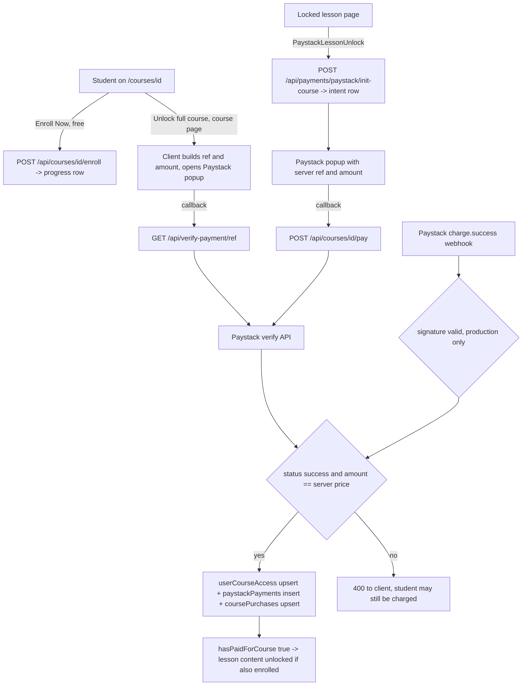

# ForexOrbit Academy — Course Purchase, Payment, Enrollment, and Security Audit

Audit date: 27 October 2026
Scope: working tree on `review/sprint-1-3-integration` (includes uncommitted local work).

Sections 1 to 12 are the original read-only audit and describe the code **before** remediation. Section 0 describes the Phase 1 code-only remediation that followed. The original audit test `tests/course-purchase-audit.test.js` asserted the vulnerable code shape and has been replaced by `tests/course-purchase.test.js`.

No Paystack call, payment, refund, database write, index creation, migration, deploy, commit, or settings change was made in either phase. No secret values were read or recorded.

---

## 0. Phase 1 remediation — one-time full-course purchase at ₦10,000

Status: **implemented in code, uncommitted, awaiting review.** Release remains **BLOCKED** until the review, the operator steps in 0.8, and the open items in 0.9 are complete.

### 0.1 Business model

- One product: full access to one course for a one-time payment of **₦10,000 NGN (1,000,000 kobo)**.
- No per-lesson sales. Enrollment stays free and never grants paid content.
- Staff roles keep their existing bypass.

### 0.2 Price configuration

- The price lives in code: `lib/course-price.js` exports `COURSE_PRICE_KOBO = 1000000`, `COURSE_CURRENCY = 'NGN'`, and the display label `COURSE_PRICE_LABEL = '₦10,000'`. The same module feeds the server and the checkout UI.
- `PAYSTACK_COURSE_PRICE_KOBO`, `NEXT_PUBLIC_PAYSTACK_COURSE_PRICE_KOBO`, `PAYSTACK_LESSON_PRICE_KOBO`, and `PAYSTACK_CURRENCY` are **no longer read**. A stale production value such as `500000` therefore cannot keep the old price. `.env.example` documents this.
- Each checkout intent stores its own `amountKobo` and `currency`. Verification compares the Paystack result against the intent, not the live constant. An intent created before deploy at the old amount is honored only for that exact amount; any other amount is rejected and recorded.
- Occurrences of `500000` were reviewed individually; outside this document, the remaining ones are test fixtures that simulate an old-price payment.

### 0.3 Purchase flow

1. `POST /api/payments/paystack/init-course` (student only, rate limited, environment gated). It checks that the course exists and returns `alreadyOwned` when the student already has access. It reconciles any open earlier intent for that student and course with Paystack before creating a new one, so a student whose earlier payment succeeded is granted instead of charged twice. It returns the server `reference`, `amountKobo`, `currency`, and the session email.
2. `PaystackCourseUnlock` opens the Paystack popup with exactly those values and metadata `{ userId, courseId }`. The browser never builds a reference or an amount.
3. The callback posts to `POST /api/courses/:id/pay`. Retryable outcomes (`payment_pending`, provider uncertain) are retried after 2 and 5 seconds. A final failure shows the reference and a support ID.
4. `confirmCoursePayment` (in `lib/course-payment.js`) is the only grant path. It is shared by the course `pay` route, `POST /api/payments/paystack/verify`, `GET /api/verify-payment/:reference`, `POST /api/verify-payment/manual`, and the webhook.

Confirmation rules:

| Condition | Result |
|---|---|
| Malformed reference | 400, no provider call |
| No intent for the reference | Never granted. A real successful charge is recorded as `no_matching_intent` and returns 409 for support review |
| Intent owned by another user | 403 |
| Intent for another course | 400 |
| Lesson intent (retired) | 410 `lesson_purchase_retired`; a real charge is recorded |
| Already settled | Grant re-applied idempotently, 200 `alreadyProcessed` |
| Provider timeout, network error, 429, 5xx, auth error, or invalid body | 503 retryable; the intent stays open |
| Provider has no record yet | 409 retryable |
| Status pending, ongoing, processing, queued | 409 retryable |
| Status failed, abandoned, reversed, or other | 402, no grant |
| Amount differs from the intent | 400 `amount_mismatch`, recorded |
| Currency is not NGN on the intent or the transaction | 400 `currency_mismatch`, recorded |
| Metadata names another user or course, or a lesson | 400 `metadata_mismatch`, recorded |
| Success and all checks pass | Grant; the intent is marked `paid` |

An intent past its 30-minute window can still be confirmed, so a slow callback or webhook does not strand a paid student.

### 0.4 Entitlement and legacy handling

- Full-course access comes **only** from `userCourseAccess` rows with `paid: true`, or with an explicit `entitlementType` of `complimentary` or `manual_grant`. `hasPaidForCourse` delegates to `hasCourseEntitlement`.
- Rows without a `paid` flag no longer count as paid. The old `paid: { $exists: false }` clause is removed.
- **Legacy lesson purchases** (`userLessonAccess` with `paid: true`, and `lessonPurchases`) unlock only the lesson they name. They never unlock the course.
- Grants are upserts. Historical purchase and access rows are never deleted or revoked by this code.
- New rows store no customer email.

### 0.5 Removed or disabled paths

| Path | Change |
|---|---|
| `POST /api/payments/paystack/init-lesson` | Returns 410 `lesson_purchase_retired`; no auth or DB access |
| Lesson branch of `POST /api/payments/paystack/verify` | Removed; lesson intents return 410 |
| `components/monetization/PaystackLessonUnlock.tsx` | Deleted; replaced by `PaystackCourseUnlock.tsx` |
| Course page `handlePay` (client reference and price) | Removed |
| `fo_course_paid_<id>` sessionStorage flag (`lib/forexorbit-course-paid.ts`) | Deleted; the page derives "paid" from the server's lock state |
| `lib/paystack-course-unlock.ts`, `lib/verify-course-paystack-payment.ts`, `lib/paystack-server.ts` | Deleted; replaced by `lib/course-payment.js` |
| `backfill-old-payment.js`, `fix-paystack-intents-backfill.js` | Replaced by stubs that print a message and exit 1. Neither was run |

### 0.6 Security and reliability fixes by finding

| Finding | Status |
|---|---|
| F1 lesson payment unlocks course | **Fixed.** Course access from paid course rows or explicit grants only; lesson rows scoped to their lesson |
| F2 client-priced checkout | **Fixed.** Server intent drives the popup; verification against the intent; mismatches recorded |
| F3 currency not checked | **Fixed.** NGN required on intent and transaction |
| F4 refunds and disputes | **Recorded only.** `refund.*` and `charge.dispute.*` events are written to `paymentExceptions` as `refund_unhandled` or `dispute_unhandled` and acknowledged. Access is not changed. Policy remains open (0.9) |
| F5 webhook signature bypass | **Fixed.** Signature always required (401 otherwise). No `NODE_ENV` branch. Payments disabled (503) when the secret is missing, when a non-`sk_test_` key is used outside production, or when a non-local database still uses the shared `Forex_elearning` name outside production |
| F6 uniqueness | **Partly mitigated.** Upserts keyed on reference and on user plus course narrow the race. Uniqueness is not guaranteed without unique indexes, which were not created (0.9) |
| F7 lost rejected charges | **Fixed.** `paymentExceptions` records mismatches, unknown references, retired lesson charges, and unreconciled webhook charges, keyed on reference plus reason with an occurrence count. Database failures return 500 so Paystack retries |
| F8 assignments | Unchanged; product decision |
| F9 provider timeout | **Fixed.** 10-second `AbortController` timeout; non-2xx and invalid bodies are treated as uncertain or not found |
| F10 rate limits | **Fixed (per process).** Checkout 10 per 10 minutes and confirm 30 per 10 minutes per user. In-memory, so limits apply per server instance |
| F11 personal data in logs | **Fixed.** Payment logs carry a support ID, route tag, reference, and result code only. Responses carry `code`, `retryable`, `message`, and `supportId`, never provider payloads |
| F12 course availability | Existence checked at checkout; availability flags remain a product decision |
| F13 client paid flag | **Fixed.** Flag removed |
| F14 backfill script | **Fixed.** Disabled |
| F15 grant types | `complimentary` and `manual_grant` are recognized. There is no admin tool to create them yet |

Database name: `lib/mongodb.ts`, `lib/mongodb.js`, and `server.js` read `MONGODB_DB_NAME` and default to `Forex_elearning`. Local work should set a separate name.

### 0.7 Regression coverage

`tests/course-purchase.test.js` has 39 tests. It is part of `npm test`.

**Behavioral tests (35).** They run the real `lib/course-payment.js`, `lib/course-price.js`, and `lib/rate-limit.js` code against an in-memory collection double and a mocked Paystack lookup. They are not integration tests against MongoDB and not browser E2E tests. Covered: the ₦10,000 price; intent creation; a single grant; duplicate callbacks and webhooks; webhook before callback; expired intent; lower amount; other currency; non-NGN intent; failed, abandoned, reversed, pending, not found, and timeout outcomes; retry after an uncertain outcome; cross-user and cross-course references; metadata naming another user, course, or lesson; references with no intent; malformed references; double-charge protection when restarting checkout; already owned; legacy lesson scope; unflagged rows; complimentary and manual grants; retired lesson checkout; no deletion of historical rows; webhook signatures; unreconciled and tampered webhooks; refund and dispute recording; storage failure surfacing; ignored events; provider normalization including timeout; public response shape; environment gating; rate limiting.

**Source-contract tests (4).** They read source files: `init-lesson` returns 410 and touches no database; the webhook has no `NODE_ENV` signature branch; `lib/lesson-monetization.ts` reads no price environment variable and no `$exists: false`; checkout pages use the server intent and the shared price label with no `₦5,000`, public price variable, or sessionStorage flag.

Mutation check: removing the amount comparison from `evaluateTransaction` made 2 tests fail (lower amount, tampered webhook amount). The original code was restored and the suite re-run.

Two existing source-contract assertions were updated to the new identifiers without changing their intent: `tests/consultation-booking.test.js` (webhook calls `processWebhookEvent`) and `tests/performance-hot-paths.test.js` (`hasPaidForCourse` delegates to `hasCourseEntitlement` and loads no lessons).

### 0.8 Operator steps before release (not performed)

- Remove `PAYSTACK_COURSE_PRICE_KOBO`, `NEXT_PUBLIC_PAYSTACK_COURSE_PRICE_KOBO`, `PAYSTACK_LESSON_PRICE_KOBO`, and `PAYSTACK_CURRENCY` from hosting settings. They are ignored, but stale values mislead.
- Confirm production runs with `NODE_ENV=production`, a live secret, and the webhook URL pointed at the API origin.
- For local or staging payment testing, use an `sk_test_` key and set `MONGODB_DB_NAME` to a non-shared database, or use a local MongoDB.
- Run a **read-only** report of legacy `userLessonAccess` and `lessonPurchases` rows and of `userCourseAccess` rows without `paid: true`, so support knows which students now see only individual lessons. No such report was run.
- Plan support handling for `paymentExceptions` (an admin view or a scheduled read-only report).

### 0.9 Remaining work and blockers

- **Refund and dispute policy (F4).** Not decided. Events are recorded only; access is not revoked automatically.
- **Unique indexes (F6).** `paystackPayments.reference` and `userCourseAccess { userId, courseId }` need a reviewed migration, tested on a disposable database first. Not created.
- **Legacy-row decision.** Students whose only access came from lesson rows or unflagged course rows now see only the lessons those rows name. Whether to convert any of them to full-course grants is a business decision. No data was changed.
- **Pre-deploy intents** at the old `500000` amount remain confirmable at that amount only.
- **Rate limits** are per process; a shared store is needed for multi-instance hosting.
- **Not executed:** Paystack sandbox or live payments, real webhook delivery, MongoDB integration tests, concurrency against MongoDB, browser checkout E2E, production checks.

### 0.10 Test commands and results (Phase 1)

| Command | Result |
|---|---|
| `node --test tests/course-purchase.test.js` | 39 passed, 0 failed |
| Same, with the amount check removed (mutation) | 37 passed, 2 failed, as expected; code restored |
| `npm test` (first run after remediation) | 2 failed: stale identifiers in the consultation and performance contract tests (updated, see 0.7) |
| `npm test` (second run) | 1 failed: the secret scanner matched a placeholder SRV URI in the new test file; the test now builds the scheme from parts |
| `npm test` (final) | **257 passed, 0 failed** |
| `npx tsc --noEmit` | 0 errors |
| `npx next lint` on the changed pages, routes, and libs | 0 errors; warnings only (existing `no-explicit-any` and one existing unused catch variable) |

---

## 1. Executive summary

**Overall risk: High.** Course entitlement is granted only after a server-side Paystack verification or a signed webhook. A forged browser callback cannot unlock a course by itself. The main risks are in how entitlement is decided after that point, and in the lack of refund, reconciliation, and durable uniqueness.

Highest-priority findings:

1. **High — A cheaper lesson payment unlocks the whole course.** `hasPaidForCourse` treats any per-lesson access row for the course as full course access. The lesson price defaults to ₦3,000 and the course price to ₦5,000.
2. **High — Charged-but-locked is likely when prices drift.** The course page checkout sends a price from a public environment variable and a client-made reference with no server payment intent. The server rejects any amount that differs from its own price, and the webhook acknowledges the failure with HTTP 200. The student is charged and nothing retries or records the problem for support.
3. **Medium — Currency is not checked.** The server compares the amount in minor units only. `d.currency` is copied into records without comparison.
4. **Medium — Refunds and disputes are not handled.** Only `charge.success` is processed. Access stays after a refund or chargeback. The access policy is not documented.
5. **Medium — Webhook signature checks depend on `NODE_ENV`.** Outside production mode a forged webhook unlocks any course for any user ID. The local `.env` points at the shared `Forex_elearning` database, so a local or misconfigured deploy writes real entitlements.
6. **Medium — No durable uniqueness or atomic writes for payments.** Reference uniqueness is a read-then-insert, not an index. Webhook and verify can race and write duplicate financial rows.

Enrollment itself is free and separate from payment. That appears intentional. Paid lesson content is gated by the payment check, but assignments are gated only by enrollment. Whether assignments are paid content is a product decision.

---

## 2. Actual purchase architecture

**Payment provider:** Paystack (Inline JS popup, `https://js.paystack.co/v1/inline.js`), with server verification through `GET https://api.paystack.co/transaction/verify/:reference`. There is no SDK; `fetch` is used directly.

**Pricing:** One global course price from environment variables. Courses have no price, currency, discount, coupon, tax, or published field in the database.

- Server: `PAYSTACK_COURSE_PRICE_KOBO` (default 500000 = ₦5,000), `PAYSTACK_LESSON_PRICE_KOBO` (default 300000 = ₦3,000), `PAYSTACK_CURRENCY` (default NGN). See `lib/lesson-monetization.ts` lines 105–122.
- Client: `NEXT_PUBLIC_PAYSTACK_COURSE_PRICE_KOBO` and a hard-coded `currency: 'NGN'` on the course page. The button label is hard-coded to "₦5,000".

**There are no orders, carts, receipts, or purchase-history screens.** The collections that record money are:

| Collection | Written by | Purpose |
|---|---|---|
| `paystackPaymentIntents` | `init-course`, `init-lesson` | 30-minute checkout session with server amount |
| `paystackPayments` | verify paths, webhook | Payment ledger, one row per reference (by convention) |
| `coursePurchases` | `persistCourseUnlockFromPaystackData` only | Per user and course purchase summary |
| `userCourseAccess` | verify paths, webhook | **Entitlement for the full course** |
| `userLessonAccess`, `lessonPurchases` | lesson verify, legacy | Per-lesson entitlement |
| `progress` | `POST /api/courses/:id/enroll` | Enrollment (free) |

**Source of truth:** Paystack's verify response for payment status. `userCourseAccess` plus `userLessonAccess` plus `lessonPurchases` (through `hasPaidForCourse`) for entitlement. `progress` for enrollment.

### Lifecycle

Two client entry points use two different confirm routes:

- `pages/courses/[id].tsx` `handlePay` (lines 54–135): client-generated reference, client amount, no intent, confirm through `GET /api/verify-payment/:reference`. A "Fix payment" box posts a reference to `POST /api/verify-payment/manual`.
- `components/monetization/PaystackLessonUnlock.tsx` (used on the locked lesson page with `unlockScope="course"`): server intent from `init-course`, confirm through `POST /api/courses/:id/pay`.

---

## 3. Routes, services, and components

| Path | Method | Auth | Role |
|---|---|---|---|
| `pages/api/payments/paystack/init-course.ts` | POST | `withAuth` | students (staff rejected) |
| `pages/api/payments/paystack/init-lesson.ts` | POST | `withAuth` | students |
| `pages/api/courses/[id]/pay.ts` | POST | `withAuth` | students; intent-bound confirm |
| `pages/api/payments/paystack/verify.ts` | POST | `withAuth` | students; intent-bound course or lesson confirm |
| `pages/api/verify-payment/[reference].ts` | GET | `withAuth` | metadata-bound confirm |
| `pages/api/verify-payment/manual.ts` | POST | `withAuth` | same as above |
| `pages/api/paystack/webhook.ts` | POST | HMAC in production | none |
| `pages/api/courses/[id]/enroll.ts` | POST, DELETE | `withAuth(['student'])` | free enrollment and withdrawal |

Services: `lib/paystack-server.ts`, `lib/paystack-course-unlock.ts`, `lib/verify-course-paystack-payment.ts`, `lib/lesson-monetization.ts`, `lib/course-lessons-locked.ts`, `lib/enrollment-state.js`, `lib/account-access.js`.

Content gates: `pages/api/lessons/[id].ts` (enrollment and payment), `pages/api/lessons/index.ts` (enrollment, then strips protected fields when priced as locked), `pages/api/quizzes/[lessonId].ts` (enrollment and `assertStudentCanAccessLessonContent`), `pages/api/assignments/*` (enrollment only).

Manual scripts at the repo root: `backfill-old-payment.js` and `fix-paystack-intents-backfill.js`.

---

## 4. Findings

Severity reflects likely business impact given the current code. "Static" means found by reading source. "Test" means asserted by `tests/course-purchase-audit.test.js`, which checks the source contract and does not execute the payment flow.

### F1 — High — A lesson payment grants full-course access

- **What is wrong:** `hasPaidForCourse` returns true when any `userLessonAccess` row has the same `userId` and `courseId`, or when any `lessonPurchases` row matches a lesson in the course.
- **Why it matters:** The lesson price defaults to ₦3,000 and the course price to ₦5,000. One lesson purchase unlocks every lesson, quiz, and lesson-list body in that course.
- **Exploit:** A signed-in student calls `POST /api/payments/paystack/init-lesson` for any paid lesson, pays the lesson price, and confirms through `POST /api/payments/paystack/verify`. That route writes `userLessonAccess { userId, lessonId, courseId, paid: true }`. Every later `hasPaidForCourse` call for that course returns true. The current UI only shows the course checkout, but the lesson routes stay live.
- **Evidence:** `lib/lesson-monetization.ts` lines 172–199 (`courseQ` is checked against `USER_ACCESS_COLLECTION`); `pages/api/payments/paystack/verify.ts` lines 150–168 write `courseId` on the lesson row. Asserted in test 4.
- **Additional detail:** `paid: { $exists: false }` also counts as paid, so any access row without a `paid` field grants access.
- **Fix:** Count only `userCourseAccess` rows with `paid: true` (or an explicit complimentary type) for course access. Keep per-lesson rows scoped to the single lesson, or retire `init-lesson` and the lesson verify branch if per-lesson sales are discontinued. Decide how existing legacy rows are treated before changing the query.
- **Regression test:** A user with only a lesson access row for course A has `hasPaidForCourse(A) === false` and can open only that lesson.
- **Status:** Potential risk, confirmed statically. Not reproduced against a database.

### F2 — High — Client-priced checkout can charge students without granting access

- **What is wrong:** The course page builds the Paystack reference and amount in the browser (`NEXT_PUBLIC_PAYSTACK_COURSE_PRICE_KOBO`, `currency: 'NGN'`), with no server intent. The server later requires `d.amount === getCoursePriceKobo()`.
- **Why it matters:** If the public and server price variables differ, or the price changes during checkout, Paystack charges the student and every confirm path rejects the payment. The webhook logs a warning and returns 200, so Paystack does not retry. No row records the failed charge for support.
- **Exploit or failure:** A tampered amount below the server price is rejected, which is correct. The real risk is legitimate payments ending charged-but-locked. The "Fix payment" box re-runs the same rejection.
- **Evidence:** `pages/courses/[id].tsx` lines 83–96 and 366; `lib/paystack-course-unlock.ts` lines 260–264 and 435–439; `pages/api/paystack/webhook.ts` lines 108–115. Asserted in test 2.
- **Fix:** Use `init-course` on the course page too, take amount, currency, and reference from the server intent, and display the server price. Store the expected amount on the intent and validate against the intent rather than the live environment variable. Record rejected-but-successful charges in a reconciliation collection and alert.
- **Regression test:** Verify uses the intent amount; a mismatch writes a reconciliation row and does not silently drop.
- **Status:** Potential risk, static.

### F3 — Medium — Currency is never validated

- **What is wrong:** Every verify path compares `d.amount` in minor units only. `d.currency` is stored, never compared to `PAYSTACK_CURRENCY` or the intent currency.
- **Why it matters:** If the Paystack account accepts more than one currency, 500000 minor units of another currency passes. Most Paystack currencies are worth more than NGN, so underpayment risk is limited, but records can be wrong.
- **Evidence:** `lib/paystack-course-unlock.ts` lines 260 and 376; `lib/verify-course-paystack-payment.ts` lines 60 and 83. Asserted in test 3 and test 6.
- **Fix:** Require `d.currency === expected currency` on every path.
- **Regression test:** A success response in another currency with the right amount is rejected.
- **Status:** Potential risk, static.

### F4 — Medium — Refunds, disputes, and reversals are not handled

- **What is wrong:** The webhook ignores every event except `charge.success`. There is no refund route, no dispute handling, and no admin tool to revoke access.
- **Why it matters:** After a refund or chargeback, `userCourseAccess` keeps `paid: true` and the student keeps access. Financial rows still say `success`.
- **Evidence:** `pages/api/paystack/webhook.ts` lines 91–93. Asserted in test 5.
- **Fix:** Depends on policy (see section 10). At minimum, record `refund.processed` and `charge.dispute.*` events against the payment row and apply the agreed access rule.
- **Status:** Confirmed gap, static.

### F5 — Medium — Webhook signature check is disabled outside production mode

- **What is wrong:** When `NODE_ENV !== 'production'` the webhook skips the signature and processes any JSON with `event: 'charge.success'`.
- **Why it matters:** Any request with `metadata.userId`, `metadata.courseId`, the server amount, and a new reference unlocks that course for that user. `npm run dev` uses the `.env` URI, which is the shared `Forex_elearning` database, so local testing writes real entitlements. A deploy that forgets `NODE_ENV=production` would be open to anyone.
- **Mitigation present:** `scripts/start-production.js` sets `NODE_ENV=production`, and local dev binds to localhost.
- **Evidence:** `pages/api/paystack/webhook.ts` lines 49 and 61–79. Asserted in test 1.
- **Fix:** Always require a valid signature when a secret is set. Use a separate Paystack test secret and a separate database for local work. Fail closed when the secret is missing.
- **Status:** Potential risk, static.

### F6 — Medium — No durable uniqueness, no transaction

- **What is wrong:** Reference uniqueness is `findOne` then `insertOne` on `paystackPayments`. No unique index on `paystackPayments.reference`, `userCourseAccess {userId, courseId}`, or Paystack event IDs is defined in the repository. Writes to access, payments, and purchases are three separate operations.
- **Why it matters:** The browser callback and the webhook usually arrive close together. Both can see no row and both insert, which duplicates financial rows. Entitlement stays single because access is an upsert, but revenue reports would double count. A crash between writes can leave access without a payment row.
- **Evidence:** `lib/paystack-course-unlock.ts` lines 48–145; `lib/verify-course-paystack-payment.ts` lines 73–104 (no existing-reference check at all; double submit before the intent delete inserts twice).
- **Recovery that works:** Webhook retry finds access present and records the payment only (lines 60–91).
- **Fix:** Add unique indexes in a reviewed migration on a non-shared database first: `paystackPayments.reference`, `userCourseAccess {userId, courseId}`. Handle duplicate-key as idempotent success. Optionally use a Mongo transaction if the cluster supports it. Do not create indexes on the shared production URI without explicit approval.
- **Status:** Potential risk, static.

### F7 — Medium — Successful payments rejected by the webhook are acknowledged and lost

- **What is wrong:** Any validation failure in the webhook (amount mismatch, missing metadata, unknown user, deleted course) returns 200 with only a console warning.
- **Why it matters:** There is no reconciliation store and no job that compares Paystack transactions with local rows. Support must find these in logs.
- **Evidence:** `pages/api/paystack/webhook.ts` lines 108–115.
- **Fix:** Write a `paymentExceptions` row with the reference and reason. Add an admin view or report.
- **Status:** Confirmed gap, static.

### F8 — Low to Medium — Assignments require enrollment only

- **What is wrong:** `decideAssignmentRead` checks enrollment, not payment. A free-enrolled student can read and submit assignments in a paid course.
- **Why it matters:** Only if assignments are meant to be paid content.
- **Evidence:** `lib/account-access.js` lines 1048–1066. Asserted in test 5.
- **Fix:** Product decision. If paid, add the `hasPaidForCourse` gate.
- **Status:** Static. Unresolved product decision.

### F9 — Low — Provider call has no timeout and ignores the HTTP status

- **What is wrong:** `paystackVerifyTransaction` calls `fetch` with no timeout or `res.ok` check.
- **Why it matters:** A slow provider holds the request open; a non-JSON error page throws and becomes a 500.
- **Evidence:** `lib/paystack-server.ts` lines 20–35.
- **Fix:** Add an `AbortController` timeout and treat non-2xx as "could not reach provider", leaving the reference retryable.
- **Status:** Static.

### F10 — Low — No rate limiting on checkout and verify routes

- **What is wrong:** `init-course`, `init-lesson`, and both verify-payment routes have no rate limit. Every verify call hits the Paystack API.
- **Why it matters:** Intent spam and provider quota use.
- **Fix:** Per-user limits on init and verify.
- **Status:** Static.

### F11 — Low — Personal data in logs

- **What is wrong:** The webhook logs the customer email on every `charge.success`. Verify routes log the full Paystack error response.
- **Evidence:** `pages/api/paystack/webhook.ts` line 105; `lib/verify-course-paystack-payment.ts` line 48.
- **Fix:** Log the reference and a masked email only.
- **Status:** Static.

### F12 — Low — Course availability is not checked

- **What is wrong:** Courses have no published, archived, or for-sale flag. `init-course` checks only that the course exists. A deleted course makes the webhook drop a paid charge (see F7).
- **Fix:** Product decision on course availability. Keep access rows and financial rows when a course is deleted.
- **Status:** Static.

### F13 — Informational — Client paid flag affects the lesson list UI only

- `writeCoursePaidClient` stores `fo_course_paid_<id>` in sessionStorage. The course page then lists every lesson. The server still strips protected fields and blocks lesson and quiz reads. No bypass, but setting the flag shows lesson titles that the server would also return. (`lib/forexorbit-course-paid.ts`, `pages/courses/[id].tsx` line 314.)

### F14 — Informational — Manual backfill script grants access without provider verification

- `backfill-old-payment.js` writes `userCourseAccess`, `paystackPayments`, and `coursePurchases` from environment variables with a default hard-coded reference and no dry-run. It requires a database URI, so it is an operator tool, but a mistaken run creates a paid record. `fix-paystack-intents-backfill.js` has `DRY_RUN`.

### F15 — Informational — Manual and complimentary access are not distinguishable

- Staff roles bypass payment. There is no complimentary access type. `source` on rows is the only hint (`paystack-verify-api`, `paystack-webhook`, `paystack-course`). Reports cannot separate paid from granted access reliably.

---

## 5. Exploit scenarios (summary)

| Scenario | Result |
|---|---|
| Call enroll directly without paying | Allowed. Enrollment is free. Paid lessons remain locked. |
| Send a fake success callback | Rejected. Every confirm path calls Paystack verify. |
| Reuse another student's reference | Rejected. Metadata or intent must match the session user; a registered reference owned by another user returns 409. |
| Change course ID on verify | Rejected. Metadata or intent course must match. |
| Pay a lower amount | Rejected (F2 side effect: charged but locked if the price drifted). |
| Pay for one lesson, open the whole course | **Possible (F1).** |
| Keep access after refund | **Possible (F4).** |
| Forge webhook on a non-production server | **Possible (F5).** |
| Race callback and webhook | Duplicate financial rows, single entitlement (F6). |

---

## 6. Safeguards that work

- Every confirm path verifies with Paystack server-side using the secret key, which never reaches the browser.
- Production webhook verifies HMAC-SHA512 over the raw body with `bodyParser: false` and `timingSafeEqual`.
- The user identity comes from the live session (`withAuth` loads the user and applies `decideAccountAccess`). Body `userId` is ignored on `/courses/:id/pay`.
- Metadata user must equal the session user on verify-payment.
- Staff roles cannot run purchase flows.
- Lesson reads and quiz reads require both active enrollment and payment.
- Withdrawn enrollment denies lesson, quiz, and assignment access without deleting history.
- Intents expire after 30 minutes.
- Lesson list strips protected fields when priced as locked.

---

## 7. Financial integrity and reconciliation

The application cannot today produce a trustworthy revenue report:

- Duplicate `paystackPayments` rows are possible (F6).
- `coursePurchases` is written only by the metadata path, not by `/courses/:id/pay` (test 6).
- Refunds and disputes are not recorded (F4).
- Rejected successful charges are only in logs (F7).
- There is no job comparing Paystack's transaction list with local rows.

A provider timeout during verify leaves the student locked. Recovery depends on the webhook arriving or the student using "Fix payment". Both are safe to retry because entitlement is an upsert.

---

## 8. Refund, dispute, and access policy gaps

These are unresolved product decisions. The code does not implement any of them:

- Should a full refund revoke course access? Partial refunds?
- Should an open dispute suspend access? A lost dispute revoke it?
- Who may issue refunds, and from where (Paystack dashboard only, or an admin screen)?
- Are complimentary or manual grants allowed, and how are they recorded?
- Are assignments part of the paid course?
- What happens to purchases when a course or user is deleted?
- Are per-lesson purchases still sold?

---

## 9. Environment and deployment

- `PAYSTACK_SECRET_KEY` is server-only. Only the public key and a price are `NEXT_PUBLIC_*`.
- `isPaystackConfigured()` is true when a secret is set. Without a secret, paid lessons stay locked and checkout returns 503; this fails closed.
- Test and live keys are not separated by code. The secret prefix (`sk_test_` or `sk_live_`) is not checked against the environment.
- The local `.env` points at the shared database, so local Paystack testing (with the dev-mode webhook bypass) writes production entitlements (F5).
- Webhook URL is documented in `.env.example` as `https://YOUR_DOMAIN/api/paystack/webhook`. With split hosting, Paystack should point at the Render origin that runs the API. This was not verified against the Paystack dashboard.

---

## 10. Tests

| Command | Result |
|---|---|
| `node --test tests/course-purchase-audit.test.js tests/enrollment-state.test.js tests/lesson-read.test.js` | First run: 21 passed, 2 failed. Both failures were wrong assertions in the new audit test and were corrected. |
| `node --test tests/course-purchase-audit.test.js` | 6 passed, 0 failed |
| `npm test` (full suite including the new file) | 224 passed, 0 failed |

The new tests are **source-contract tests**. They confirm the code shape behind F1–F5 and F8. They do not run Paystack, MongoDB, or a browser.

Not executed: real or sandbox Paystack payments, webhook delivery, concurrency against MongoDB, refund flows, browser checkout, production checks.

---

## 11. Recommended remediation order

1. **F1** — restrict course access to `userCourseAccess` paid rows; retire or scope per-lesson purchases. Decide legacy-row treatment first.
2. **F5** — require webhook signatures in every environment that has a secret; separate local database and test keys.
3. **F2 + F3** — course page uses `init-course`; validate amount and currency against the intent; show the server price.
4. **F7** — record rejected successful charges for support.
5. **F6** — unique indexes and duplicate-key idempotency, tested on a disposable database before any production migration.
6. **F4** — implement the agreed refund and dispute policy.
7. **F9, F10, F11** — timeouts, rate limits, log hygiene.
8. **F8, F12, F15** — after product decisions.

### Phased plan

- **Phase A (code only, no migration):** F1, F5, F2, F3, F9, F11, with unit tests.
- **Phase B (data):** reconciliation collection (F7), index plan (F6) reviewed and applied by the operator.
- **Phase C (policy):** refunds and disputes (F4), complimentary access (F15), assignment gating (F8), course availability (F12).

---

## 12. Decisions needed

- Refund and dispute access policy.
- Whether per-lesson purchases continue and how existing lesson rows are treated.
- Whether assignments are paid content.
- Whether the Paystack account accepts currencies other than NGN.
- Who may run the backfill scripts, and whether they should be removed from the repo root.
- Approval and timing for unique indexes on the production database.

Release status remains BLOCKED. Phase 1 code remediation is described in section 0; the items in 0.9 remain open.
